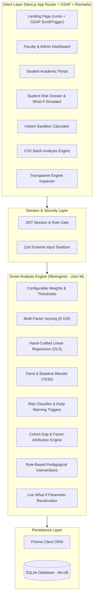

# AcadRisk System Architecture & Engineering Documentation

AcadRisk is an AI-free, transparent, and explainable Academic Risk Analysis and Performance Prediction platform designed for higher education institutions.

---

## 1. High-Level Architecture Diagram

---

## 2. Mathematical Formulations

### A. Performance Score Formula ($S_{current}$)
$$S_{current} = \min\Big(100, \max\big(0, \sum w_i \cdot x_i^{norm} - P\big)\Big)$$

Where:
- Attendance ($w_1 = 0.20$): $x_1 \in [0, 100]$
- Internal Marks ($w_2 = 0.30$): $x_2 = \frac{1}{|Subjects|} \sum \frac{t_1 + t_2 + t_3}{3}$
- Assignment Completion ($w_3 = 0.15$): $x_3 \in [0, 100]$
- Prior Semester GPA ($w_4 = 0.15$): $x_4 = \frac{GPA}{10} \times 100$
- Weekly Study Hours ($w_5 = 0.10$): $x_5 = \min\big(100, \frac{Hours}{20} \times 100\big)$
- Classroom Participation ($w_6 = 0.05$): $x_6 = \frac{Participation}{5} \times 100$
- Deductions ($P \le 5.0$): $P = \min\big(5.0, 2.0 \times Backlogs + 0.75 \times LateSubmissions\big)$

### B. Hand-Written Linear Regression (Ordinary Least Squares)
Given monthly composite scores $(x_1, y_1), \dots, (x_N, y_N)$ over $N = 6$ evaluation checkpoints:
$$\bar{x} = \frac{1}{N} \sum_{i=1}^N x_i, \quad \bar{y} = \frac{1}{N} \sum_{i=1}^N y_i$$
$$m = \frac{\sum (x_i - \bar{x})(y_i - \bar{y})}{\sum (x_i - \bar{x})^2}, \quad c = \bar{y} - m\bar{x}$$
$$R^2 = \frac{\big[\sum (x_i - \bar{x})(y_i - \bar{y})\big]^2}{\sum (x_i - \bar{x})^2 \cdot \sum (y_i - \bar{y})^2}$$

Projected exam score at month $N+1$:
$$y_{proj} = \operatorname{clamp}(m \cdot (N+1) + c, 0, 100)$$

Blended final prediction:
$$S_{pred} = 0.70 \cdot y_{proj} + 0.30 \cdot S_{current}$$

### C. Risk Classification & Early Warning Triggers
- **Low Risk**: $S_{pred} \ge 70.0$
- **Moderate Risk**: $50.0 \le S_{pred} < 70.0$
- **High Academic Risk**: $S_{pred} < 50.0$
- **Early Warning Flag**: Raised if Attendance $< 75\%$ OR $\Delta_{score} < 0$ for 3 consecutive months.

---

## 3. Ethical Safeguards & Transparency
AcadRisk adheres to strict algorithmic transparency principles:
1. No black-box neural networks or unsupervised embeddings.
2. Every point deduction is mathematically traceable to specific raw metrics.
3. Explicit ethical disclosure banner shown across all faculty views: tools exist to guide support and mentorship, never to penalize or stigmatize students.
