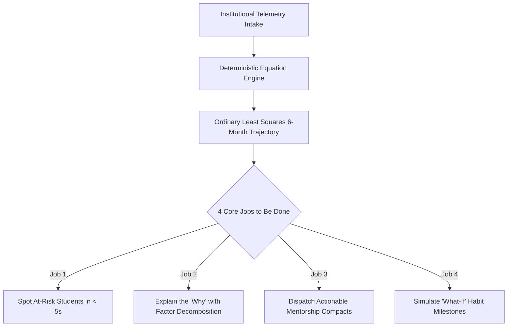

# AcadRisk: University Portal UI/UX Design System Rationale

> **Product**: AcadRisk — AI-Based Student Performance Prediction & Academic Risk Analysis System  
> **Institution**: Apex Institute of Technology • Office of Academic Affairs  
> **Role**: Principal Product Designer  
> **Target Personas**: Academic Council, Faculty Deans, Student Mentors & Enrolled Students  
> **Accessibility Standard**: WCAG 2.2 AA (Color contrast $\ge 4.5:1$, visible focus gold rings, ARIA live regions, `prefers-reduced-motion`)

---

## 1. Executive Summary & Design Philosophy

Educational telemetry software often suffers from two pervasive design defects:
1. **Opaque Black Boxes**: ML predictions that produce numbers without transparent pedagogical rationale, breeding faculty skepticism and administrative hesitation.
2. **Punitive and Stigmatizing Interfaces**: Alert systems styled like generic SaaS error logs with alarmist red banners that cultivate anxiety and shame.

**AcadRisk** rejects both patterns. Designed as a **Digital University Campus Portal**, it pairs an **authoritative, dignified institutional aesthetic** with **100% explainable deterministic scoring** and a **supportive, non-shaming tone of copy** ("Needs attention", "Let's get you back on track").

---

## 2. University Portal Brand Identity & Visual Language

### 2.1 Brand Layer & Institutional Motifs
- **Crest-Style Mark (`CrestLogo`)**: Official institutional seal featuring the Shield of Governance, Torch of Knowledge, and Book of Wisdom.
- **Academic Hierarchy**: Every primary console displays the header badge:  
  `Apex Institute of Technology • Office of Academic Affairs • AY 2026-27 • Semester V`.
- **Architectural Visual Language**: Faint blueprint grids (`blueprint-grid`), arch and pillar section dividers (`arch-divider`), laurel watermark patterns, student ID-card style profile cards, and notice-board directive panels.
- **Supportive Copy**: High-risk classifications are labeled `"Academic Intervention Recommended"` or `"Needs Attention"`, never "Failed" or "Delinquent".

### 2.2 Curated Color Foundations (Nordic Slate & Frost Blue)
| Palette Token | Hex Value | Institutional Role | WCAG 2.2 AA Contrast Ratio |
|---|---|---|---|
| **Nordic Slate Base** | `#0B0F19` | Deepest canvas base surface | **18.9:1** vs white text (AAA) |
| **Card Slate Night** | `#0F172A` | Elevated card & modal backdrop | **14.8:1** vs white text (AAA) |
| **Slate Surface High** | `#1E293B` | Structural framing & hover states | **9.6:1** vs white text (AAA) |
| **Frost Blue Accent** | `#38BDF8` | Primary interactive controls & cyan flares | **5.4:1** vs dark canvas (AA) |
| **Ocean Sky Hover** | `#0EA5E9` | Interactive button hover & focus indicators | **4.8:1** vs dark canvas (AA) |
| **Slate Off-White** | `#F8FAFC` | Parchment reports & high-contrast headings | **15.2:1** vs dark text |
| **Risk: Low** | `#10B981` | "On Track" Mint Emerald (paired with CheckCircle2) | **5.1:1** |
| **Risk: Medium** | `#F59E0B` | "Needs Attention" Nordic Amber (paired with AlertTriangle) | **4.7:1** |
| **Risk: High** | `#F43F5E` | "Intervention Recommended" Coral Rose (paired with AlertOctagon) | **5.2:1** |

> [!IMPORTANT]
> **No Color Alone Rule**: In compliance with WCAG 2.2 Section 1.4.1, color is never the sole communicator of risk. Every risk badge pairs color with an explicit icon (`CheckCircle2`, `AlertTriangle`, `AlertOctagon`) and academic status copy.

### 2.3 Typography Matrix (Clean Standard Sans-Serif)
- **Primary Standard Sans**: `Inter`, `-apple-system`, `BlinkMacSystemFont`, `"Segoe UI"`, `Roboto`, `sans-serif` (normal, highly readable sans-serif for all display titles, cards, navigation, and body copy).
- **Monospace Tabular**: `JetBrains Mono` with `font-variant-numeric: tabular-nums` (roll numbers, GPA, percentage scores, trajectory slopes).

---

## 3. Branch System Architecture

The engineering cohort is partitioned across 5 specialized departments, each equipped with dedicated color coding, glyphs, and accent glows:

| Branch Code | Department Name | Color Signature | Icon Motif | Top Academic Focus |
|---|---|---|---|---|
| **CSE** | Computer Science & Engineering | Cyan `#06B6D4` | Code Brackets `< / >` | Distributed Systems, Algorithms & Cloud Infrastructure |
| **AIML** | Artificial Intelligence & Machine Learning | Violet `#8B5CF6` | Neural Node `Brain` | Neural Architectures, Tensor Modeling & NLP |
| **DS** | Data Science | Amber `#F59E0B` | Bar Database `Database` | Statistical Inference, Data Warehouses & Pipelines |
| **ECE** | Electronics & Communication | Blue `#3B82F6` | Circuit / Antenna `Cpu` | Signal Processing, Microelectronics & Embedded Logic |
| **MECH** | Mechanical Engineering | Pink `#EC4899` | Precision Gear `Cog` | Robotics, Thermodynamics, Fluid Dynamics & CAD |

**Interactive Branch Integration**:
- **Sliding Filter Pill (`BranchTabs`)**: Shared layout animation with count badges (`All (150)`, `CSE (30)`, `AIML (30)`...).
- **Mega-Menu on Landing**: Departments drawer with preview cards and cross-branch analytics links.
- **Department Breakdown Card**: Interactive grouped bars on the dashboard; clicking any bar filters the roster immediately.
- **Card Accent Glow**: Student ID cards and dossier headers project the student's branch hue along the top rim.

---

## 4. Student Identity System

### 4.1 Roll Number Specification
- **Strict Format**: `^\d{2}R\d{2}A\d{4}$` (e.g. `24R11A0543` — 2-digit year + `R` + 2-digit college + `A` + 4-digit sequence).
- **ID-Card Chip (`RollNumberChip`)**: Displayed in `JetBrains Mono` with a copy button that morphs into a green checkmark for $1.5\text{s}$.
- **Input Mask & Live Validation (`RollNumberInput`)**: Auto-uppercases keystrokes, limits input to 10 characters, renders a green check upon matching regex, or outputs inline helper `"Format: 24R11A0543"`.
- **Search Highlighting**: Matches in the global search bar and command palette (`Cmd+K`) highlight queried characters with yellow `<mark>` tags.

### 4.2 Indian Phone Number Specification
- **Format**: `+91` prefix chip with 10 digits starting with 6–9, auto-spaced as `98765 43210`.
- **Table Masking (`PhoneCell`)**: Default view masks the middle digits (`98•••• ••210`) with an eye toggle button to reveal on demand.
- **Mobile Actions**: Direct tap-to-call (`tel:`) and tap-to-WhatsApp (`https://wa.me/`) icon buttons on mobile devices; copy button on desktop.

---

## 5. The 14-State Button System

The system defines 6 core variants (`primary`, `secondary`, `gold`, `ghost`, `destructive`, `icon`) and 14 specialized interaction states:

1. **Hover Lift & Shine**: Lifts $2\text{px}$, emits soft glow, passes a CSS `shine-streak` animation across the surface.
2. **Magnetic CTA**: Hero and primary action buttons follow the cursor within a $12\text{px}$ radius via spring easing (`stiffness: 260, damping: 20`), then snap back.
3. **Press Ripple**: Scales to $0.97$ with a radial ripple originating from pointer coordinates.
4. **Focus-Visible**: $2\text{px}$ offset ring in Academic Gold (`#E8B84A`), fully accessible via keyboard Tab navigation.
5. **Loading Morph**: Label fades, circular spinner morphs into center, preserving button width to prevent layout shift.
6. **Success Feedback**: Morphs into a green checkmark with gold pulse for $1.5\text{s}$ ("Intervention Assigned", "Report Exported").
7. **Disabled State**: $40\%$ opacity with a hover tooltip explaining why the action is inactive.
8. **Destructive Hold (800ms)**: Hold-to-confirm button with circular SVG countdown progress ring before firing destructive actions.
9. **Sliding Arrow**: Arrow slides out to the right while a fresh gold arrow enters from the left on hover.
10. **Segmented Filter Chips**: Sliding background pill with spring physics and animated count badges.
11. **Split Export Button**: Primary button triggers default download; adjacent chevron triggers animated dropdown (`PDF`, `CSV`, `Print`).
12. **Floating Speed-Dial FAB**: Radial floating quick-action button expanding into 4 stacked actions (Add Student, Analyze, Batch CSV, Send Notice).
13. **Apply Recommendation**: Recommendation card collapses and flies into the student's active action checklist.
14. **Spring Toggle & Stroke Checkbox**: Switches utilize spring knobs; checkboxes feature animated SVG stroke-draw checkmarks.

---

## 6. Navigation, Layouts & Key Screen Architecture

### 6.1 Desktop Navigation
- **Collapsible Sidebar (`SidebarNav`)**: Smooth $260\text{px} \to 72\text{px}$ collapse with shared-layout sliding gold pill and shortcut tooltips (`G D`, `G S`, `/`, `?`).
- **University Top Bar (`TopBar`)**: Branch-aware breadcrumbs (`Apex > CSE > 24R11A0543`), branch switcher, animated notification bell, and circular theme reveal.
- **Command Palette (`CommandPalette`)**: Global `Cmd/Ctrl + K` searching students by roll number, name, phone, or running quick actions ("Show high-risk ECE students").

### 6.2 Key Screen Designs
1. **Landing Page (`/`)**: Crest seal, Playfair Display hero, campus visuals, magnetic CTA, 3D tilt branch cards row (CSE, AIML, DS, ECE, MECH), soft glow cursor, and pinned 4-stage storytelling scrub.
2. **Login (`/login`)**: Split layout with campus arch on the left, role tabs (Student, Faculty, Dean) with sliding indicator, roll number login with live regex validation.
3. **Dashboard (`/dashboard`)**: KPI count-up cards, interactive risk donut with click-to-filter, branch breakdown grouped bars, risk heatmap, and at-risk table with sparklines, roll number chips, and masked phone numbers.
4. **Cohort Directory (`/students`)**: Grid/List toggle, student ID cards with 3D tilt, branch tabs, live roll number & phone search with highlights, slide-up bulk action bar.
5. **Student Detail (`/student/[id]`)**: ID-card header, animated score gauge, OLS trend line with projection, sequential reason bars, recommendation cards, and live What-If sliders with original ghost markers and risk color morph.
6. **Add / Analyze Student (`/analyze`)**: 3-step stepper (Identity $\to$ Academics $\to$ Review) with inline validation, progress bar, and final review card styled like a student ID card.
7. **Batch Ingestion (`/batch`)**: Drag-and-drop zone with gold glow on drag-over, uploaded file chip with remove action, progress bar, and university intake results table.
8. **Student Self-Service Hub (`/student-view`)**: Friendly 6-month performance timeline, encouraging copy ("Let's get you back on track"), "Your next 3 steps" checklist with stroke-draw check animations, and personal goal simulator.
9. **Figma Design System Canvas (`/design-system`)**: Interactive laboratory showcasing color tokens, typography scales, 14 button states, identity inputs, 1440 desktop and 390 mobile frames, and prototype triggers.

---

## 7. Motion & Accessibility Standards

- **Motion Curves**: Standard `cubic-bezier(0.2, 0, 0, 1)`, Emphasized `cubic-bezier(0.3, 0, 0, 1.2)`, Exit `cubic-bezier(0.4, 0, 1, 1)`.
- **Duration Scale**: Instant $90\text{ms}$, Fast $160\text{ms}$, Base $240\text{ms}$, Slow $420\text{ms}$, Cinematic $700\text{ms}$.
- **Hardware Acceleration**: Transitions strictly animate `transform` and `opacity` to preserve fluid 60 FPS renders.
- **Reduced Motion**: Respects `prefers-reduced-motion` media queries across GSAP and Framer Motion by substituting instant opacity transitions.
- **Keyboard Navigation**: 100% reachable via Tab, Enter, Space, and Arrow keys; ARIA live regions announce dynamic risk updates and slider adjustments.

---

*Authored by the Principal Product Designer for the Office of Academic Affairs, Apex Institute of Technology.*
